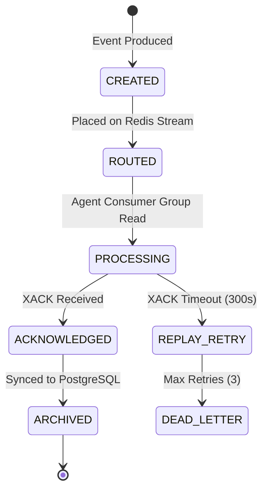

# MIRAGE — Experiment Recorder & Simulation Runtime Specification (ERS)
**Version:** 1.0  
**Date:** 2026-06-02  
**Status:** Implementation-Ready  

---

## Section 1 — Runtime Philosophy

### 1.1 Determinism Requirements
To qualify as a systems-research-grade project, MIRAGE MUST satisfy the **Strict Determinism Invariant**: 
> "Given Identical(Scenario, Seed, CodeVersion, ModelConfig), the system MUST produce Identical(OperationalStateSequence, MetricOutputs)."

### 1.2 Tick-Based Execution
The simulation operates on discrete time steps (Ticks). 1 Tick = 1 Hour of simulated disaster time. Real-time compute speed is decoupled from simulation time via a speed multiplier $\alpha$.

### 1.3 Reproducibility Guarantees
- No Python `random` calls outside the seeded simulator.
- LLM calls use `seed` and `temperature=0`.
- All Redis Streams utilize explicit sequence IDs if replaying.

---

## Section 2 — Simulation Clock (Authoritative Tick Order)

Each tick follows a non-negotiable sequential execution order to prevent race conditions between Digital Twins and Agents.

| Step | Action | Description | Ownership |
|:---|:---|:---|:---|
| **1** | **Cyclone_Update** | Update Eye position, Cat, and Intensity. | Cyclone DT |
| **2** | **Infra_Update** | Calculate probabilistic road/power failures based on (1). | Infra DT |
| **3** | **Pop_Update** | Update evac status and movement targets based on (1) and (2). | Pop DT |
| **4** | **Shelter_Update** | Increment occupancy; update damage state from (2). | Shelter DT |
| **5** | **Resource_Update**| Decrement stock based on occupancy in (4). | Resource DT |
| **6** | **Bus_Sync** | Flush all DT changes to Redis Blackboard; Publish `WORLD_STATE_UPDATED`. | Sync Engine |
| **7** | **Agent_Loop** | Execute Risk -> Shelter -> Resource -> Logistics -> Conflict. | LangGraph |
| **8** | **Approval_Wait** | Block for $T_{wait}$ or until `APPROVAL_RECEIVED` event fires. | Workflow Engine |
| **9** | **Task_Exec** | Advance `status` of active tasks; move vehicles on paths. | Logistics Agent |
| **10** | **Recorder_Snap** | Finalize tick state; Write atomic snapshot to persistence buffer. | Recorder |

---

## Section 3 — Event Lifecycle

### 3.1 State Diagram: Event Lifecycle

### 3.2 Event Persistence
- **Live**: Redis Streams (Channel: `mirage:events`)
- **Audit**: PostgreSQL Table (`event_log`)

---

## Section 4 — Experiment Recorder Architecture

### 4.1 Recorder Components
- **Snapshotter**: Captures the entire Redis Blackboard state + event log at Step 10.
- **Metric Compute Engine**: Calculates derived metrics (M1–M8) in real-time.
- **Buffer Service**: In-memory queue to prevent disk I/O from blocking the simulation loop.
- **Persistence Driver**: Flushes buffers to CSV/Parquet patterns.

### 4.2 Buffering & Persistence Strategy
- **Tick Buffering**: Metrics are held in memory during the tick.
- **Atomic Persistence**: At Step 10, a `Commit` call flushes all tick data.
- **Asynchronous Flush**: The secondary thread writes to disk while the next tick begins.

---

## Section 5 — Metric Capture Specification

| Metric | Formula | Capture Point | Calculation Procedure |
|:---|:---|:---|:---|
| **M1: Decision Latency** | $T_{processed} - T_{event\_issued}$ | Agent ACK | Log wall-clock ms at event creation and acknowledgement. |
| **M2: Resource Efficiency** | $\sum \frac{Delivered\_Qty}{Req\_Qty}$ | Task Completion | Compare Task `target_qty` vs. final `actual_delivered` in DB. |
| **M3: Allocation Quality**| $1 - \frac{Shelters\_in\_Shortage}{Total\_Shelters}$ | Step 5 (Resource DT) | Count shelters where `stock < 0` at end of tick. |
| **M4: Conflict Accuracy**| $Accuracy(Exp_{rec}, Agent_{rec})$ | Conflict Node | Intersection between Agent output and Ground Truth (GT-XX). |
| **M5: Replan Speed** | $T_{new\_plan} - T_{failure\_pulse}$ | Replan Gate | Measure time from `INFRA_FAIL` event to `TASK_UPDATED` event. |
| **M6: Explainability** | Likert [1-5] (Human Evaluation) | Approval Node | Captured via EOC Dashboard during HITL loop. |
| **M7: Resilience** | Count(Critical\_Tasks\_Completed) | Sim Termination | Filter for high-priority tasks in `tasks` table. |
| **M8: Audit Completeness**| \% Validated Log Entries | Sim Termination | Count missing `approver_id` or `reason` fields in `decisions`. |
