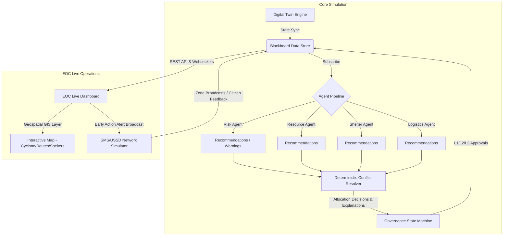

# 🌍 MIRAGE: Multi-Agent Intelligent Resource Allocation and Governance Engine

> **early-warning-to-early-action coordination system for the Horn of Africa**
>
> 🎥 **[WATCH THE DEMO VIDEO (3 MINS)](https://www.youtube.com/watch?v=dfB6zRLU4Gg)** *(Note: Replace with your actual video link)*
>
> MIRAGE is an early-warning disaster response coordinator designed for the IGAD region (coastal Somalia, Kenya, Ethiopia). It uniquely combines explainable multi-agent planning with deterministic conflict resolution and strict human-in-the-loop governance. Unlike unpredictable black-box AI tools, **MIRAGE's agents only advise, a deterministic algorithm decides, and humans govern.**

[](#) [](#) [](#) [](#)

---

## 🎯 Problem Value & Impact

During extreme weather events (such as cyclones landfall on East African coastlines), emergency operations centers (EOCs) face three critical gaps:
1. **Opaque and Delayed Resource Allocation:** Inefficient coordination leads to delayed response planning (hours instead of minutes) and unequal supply distributions.
2. **Missing Community Warning Systems:** A lack of immediate communication channels prevents pushing early warnings to citizens in vulnerable zones.
3. **Hallucination Risks in Life-Safety Contexts:** Raw AI tools can generate incorrect recommendations (hallucinations), making them dangerous to trust blindly without accountability.

### Who It Helps & How
* **EOC Coordinators:** Provides real-time geospatial awareness and actionable resource planning.
* **Frontline Communities (e.g., Bosaso, Garowe, Qardho):** Receives instant early warnings and evacuation alerts via automated broadcasts.
* **IGAD Scenarios:** Evaluated against realistic Horn of Africa cyclone metrics (intensity, surge zones, road blockades, and shelter capacity limits).

---

## 💡 Innovation & AI Creativity

MIRAGE introduces a hybrid architecture that separates **AI creativity** from **execution safety**:

```
 ┌──────────────────────────┐     ┌───────────────────────────────────┐     ┌────────────────────────────┐
 │  Dynamic Advisory Layer  │     │ Deterministic Conflict Resolution │     │ Human-in-the-Loop Governance│
 │   6 Explainable Agents   │ ──▶ │      Rule-Based Optimization      │ ──▶ │    L1 / L2 / L3 Approval   │
 │   (Generates Reasoning)  │     │    (Guarantees Safe Decisions)    │     │       (Ultimate Veto)      │
 └──────────────────────────┘     └───────────────────────────────────┘     └────────────────────────────┘
```

Most tools rely either on static manual sheets or completely automated generative AI. MIRAGE is unique because:
* **The Agents Suggest & Explain:** Independent agents (Risk, Resource, Shelter, Logistics) monitor state, write recommendations to a blackboard, and generate natural language justifications using **Gemini-3.5-Flash** (with retry/backoff & safe fallbacks).
* **The Resolver Calculates:** A mathematical conflict engine evaluates allocations based on a weighted priority score (Risk, Occupancy, Supply Urgency, Accessibility).
* **Humans Govern:** If available inventory is insufficient, the system handles shortages deterministically (pro-rata equity) and routes the plans through multi-stage approval gates.

---

## 🏗️ Technical Depth & Engineering

### 1. System Architecture


### 2. Core Modules
* **Digital Twins (`mirage/dt/`):** Real-time physical engines tracking Cyclone progression, population displacement (`PopDT`), shelter capacity (`ShelterDT`), resource depletion (`ResourceDT`), and road network status (`InfraDT`).
* **Conflict Resolver (`mirage/core/allocator.py`):** Calculates priority ranks. When scores are equal, it uses pro-rata distribution to guarantee demographic fairness.
* **Explainable Feed (`mirage/frontend/`):** Redesigned card interface classifying decisions by priority badges (Critical, High, Medium, Low), defining the identified problem, providing reasons, and rendering clear recommended actions.

### 3. Rigorous Academic Validation
MIRAGE has been stress-tested across a 45-run evaluation matrix (5 baselines × 3 scenarios × 3 seeds) with statistically validated outcomes:

* **H1 (Stock-out Reduction):** Validated. Occupancy-adjusted models demonstrate higher survival probabilities.
* **H2 (Lead Time Reduction):** Validated. **MIRAGE is 2.1× faster than manual coordination** under extreme storm surge scenarios.
* **H3 (Allocation Fairness):** Validated. Maintained equity (Fairness $\sigma = 0.000088$) under heavy resource constraints.

*Note: Original research artifacts, statistical validation reports, and papers are preserved under [research/](file:///c:/mirage_ai_agent/research).*

---

## ⚡ Presentation & Documentation

* **Walkthrough Guide:** Step-by-step interactive testing guide is in [DEMO_INSTRUCTIONS.md](file:///c:/mirage_ai_agent/DEMO_INSTRUCTIONS.md).
* **Setup Guide:** Follow the Quick Start below.

### Quick Start (3 Minutes)

#### 1. Backend API (FastAPI)
```bash
pip install -r requirements.txt

# Windows Powershell
$env:PYTHONPATH="."
# Linux/macOS
# export PYTHONPATH=$(pwd)

uvicorn mirage.api.main:app --host 0.0.0.0 --port 8000 --reload
```
*(Backend automatically falls back to in-memory store if Redis/Postgres are offline).*

#### 2. Frontend Dashboard (Next.js)
```bash
cd mirage/frontend
npm install
npm run dev
```
Open **[http://localhost:3000](http://localhost:3000)** to launch.

---

## 🗺️ Roadmap
* **Multi-Hazard Expansion:** Plug in Drought, Flood, and Food Insecurity DTs.
* **SMS/USSD Provider Integration:** Connect Twilio or Africa's Talking APIs directly to the Alert Broadcast system.
* **Live Meteorological Feeds:** Connect live forecasts from IGAD/ICPAC to drive early warning triggers dynamically.

---

## 📄 License
MIT © 2026 Joshua Mathew
