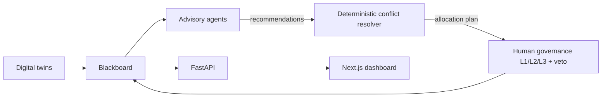

# MIRAGE: Multi-Agent Disaster Response and Governance Engine

> MIRAGE is an early-warning to early-action research prototype for the Horn of Africa. It combines digital twins, advisory agents, deterministic resource allocation, and human approval gates. **Agents advise, a deterministic algorithm decides, humans govern.**
>
> [Watch the project demo](https://www.youtube.com/watch?v=dfB6zRLU4Gg)

## Problem and innovation

Emergency operations centers often coordinate evacuation, shelter capacity, and supply requests through delayed, fragmented information. Generative systems can help explain changing conditions, but their free-form outputs are hard to audit as resource decisions. MIRAGE pairs a changing digital twin with an advisory agent team and a deterministic resolver: each allocation follows visible risk, occupancy, stock urgency, and access factors, while approval transitions remain explicit and can be vetoed. This is a research prototype for testing accountable coordination under simulated cyclone conditions.

## What it demonstrates

Cyclone, infrastructure, population, shelter, and resource digital twins update a shared blackboard. Advisory agents produce recommendations. The conflict resolver ranks requests using risk, occupancy, supply urgency, and accessibility. If requests tie at the shortage boundary, it shares remaining stock pro rata; request IDs provide stable ordering for reproducibility. Governance routes resulting actions through L1/L2/L3 approval thresholds and supports veto. The research CLI simulates approvals with a test governor; the API leaves requests pending for an operator at `GET /approvals`, with decisions submitted to `POST /approvals/decision`. The local demo and API work without an LLM key, Postgres, or Redis.

Gemini is optional and can be used by advisory integrations only. Allocation quantities are never generated by a language model. Install `requirements-ai.txt` and set `GEMINI_API_KEY` to enable the optional Gemini adapter; `GEMINI_MODEL` defaults to `gemini-2.5-flash`.

## Architecture



## Quickstart

Python 3.10+ is required. The base install uses in-memory state and needs no Docker services.

```bash
python -m venv .venv
# Windows PowerShell: .venv\Scripts\Activate.ps1
# macOS/Linux: source .venv/bin/activate
python -m pip install -r requirements.txt
python main.py
```

The 72-tick deterministic Scenario A demo writes CSV run data and a self-contained report to `outputs/run_report.html`. It runs offline and does not need `GEMINI_API_KEY`.

To start the API without Docker:

```bash
uvicorn mirage.api.main:app --host 127.0.0.1 --port 8000
```

To run the dashboard in a second terminal:

```bash
cd mirage/frontend
npm install
$env:NEXT_PUBLIC_API_URL="http://localhost:8000" # PowerShell
npm run dev
```

Use `export NEXT_PUBLIC_API_URL=http://localhost:8000` on macOS/Linux. Open http://localhost:3000.

### Optional services

Copy `.env.example` to `.env` and edit the obvious placeholder credentials. `docker compose up --build` starts the API, Postgres/PostGIS, and Redis. Leave `DATABASE_URL` and `REDIS_URL` blank when running Python directly to use the in-memory blackboard. Do not put real credentials in source control.

### Optional Gemini advisory

```bash
python -m pip install -r requirements-ai.txt
# Set GEMINI_API_KEY in your shell or ignored .env file.
```

## Reproducing evaluation results

Run the deterministic research evaluation matrix with:

```bash
python scripts/run_research_validation.py
```

It compares five baselines across three scenarios and three seeds (45 runs). This executes 45 runs (3 scenarios ? seeds 101/202/303 ? 5 baselines), each for 48 ticks. Runtime depends on hardware; output is written to a new timestamped `outputs/evaluation/run_*/` folder so prior runs are preserved. The generated report contains the evaluation numbers. Research findings are not guaranteed outcomes of every scenario or machine. To regenerate benchmark inputs, use `python scripts/generate_benchmarks.py`.

## Tests and CI

```bash
python -m pytest
cd mirage/frontend && npm ci && npm run build
```

Tests use in-memory state and local/mock adapters; no API key or network service is required. GitHub Actions runs pytest and the frontend production build.

## Project structure

- `mirage/dt/`: cyclone, infrastructure, population, shelter, and resource twins.
- `mirage/agents/`: risk, shelter, resource, logistics, communication, and governance advisers.
- `mirage/core/allocator.py`: deterministic conflict resolver and allocation explanations.
- `mirage/core/governance.py`: approval thresholds, state transitions, and veto.
- `mirage/api/` and `mirage/frontend/`: FastAPI service and Next.js operations dashboard.
- `scripts/run_research_validation.py`: 45-run evaluation matrix.

## License

MIT ? 2026 Joshua Mathew
