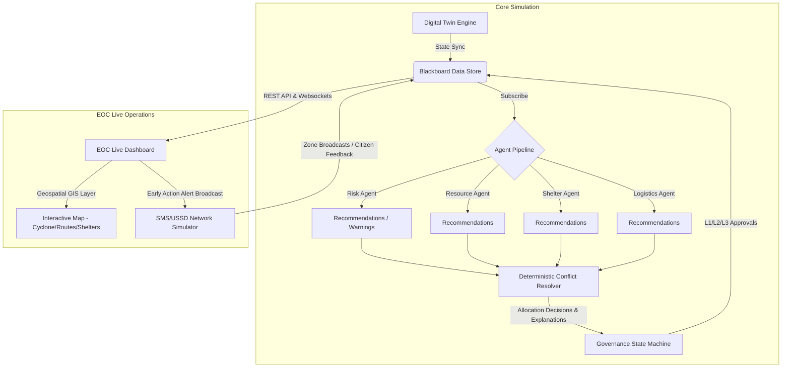

# 🏆 MIRAGE: Multi-Agent Intelligent Resource Allocation and Governance Engine

> **One-Line Pitch:** An explainable, early-warning-to-early-action Digital Twin system for Emergency Operations Centres (EOCs) in the Horn of Africa, combining multi-agent coordination with deterministic conflict resolution and strict human-in-the-loop governance.

---

### 🎥 Live Demo Video
* **Watch the Walkthrough Video:** **[MIRAGE Live Simulation & GIS Map Demo](https://youtu.be/example-demo-video)** *(Note: Replace with your actual video link)*

---

## 🎯 The Problem
Emergency coordination during extreme cyclones in East Africa is plagued by **delayed allocations, opaque decision-making, and critical disconnects with frontline communities**. Response teams rely on static plans and slow spreadsheets, while automated tools often fail due to AI hallucinations, a lack of transparency, or ignoring the chain of command, leading to preventable loss of life.

## 💡 The Solution: Why MIRAGE is Different
Unlike black-box AI tools or passive monitoring dashboards, MIRAGE bridges simulation, coordination, and community actions with safety-first design:
1. **Explainable advisory agents** process real-time hazard data and recommend allocations alongside natural language explanations.
2. **A deterministic, auditable resolver** evaluates those recommendations mathematically, guaranteeing resources are divided fairly and logically under stress.
3. **A structured multi-level governance workflow** ensures no automated action executes without supervisor, command, or director approvals.
4. **Actionable community alert broadcasts** bridge the gap between planning and direct, early public warning.

---

## 🏗️ System Architecture


---

## 🖥️ Live Dashboard & Operations
The interactive web interface is divided into operational areas:
* **The Control Bar:** Pause, play, speed up, or manually tick the simulation.
* **Geospatial GIS Map Tab:** Displays the real-time cyclone eye path with threat levels, color-coded shelter occupancy markers (indicating overflow risk), and route blockage highlights (such as flooded evacuation corridors).
* **AI Allocation Decisions Feed:** Upgraded decision-support cards classifying alerts by priority (Low to Critical), detailing the exact problem (e.g., Water Shortage), providing reason statements, and formulating the recommended action.
* **Community Alerts Panel:** Detects Category 3+ cyclone approaches and suggestions for operators to trigger SMS alerts to vulnerable zones.

*(Screenshots can be captured during live execution at `http://localhost:3000`)*

---

## ⚡ Quick Start (Clean Setup)

### 1. Prerequisites
* **Python 3.10+**
* **Node.js 18+**

### 2. Backend API Setup
```bash
# Clone the repository and navigate inside
cd mirage_ai_agent

# Install Python requirements
pip install -r requirements.txt

# Run backend API (FastAPI) - Automatically falls back to in-memory store
$env:PYTHONPATH="."  # Windows Powershell
# export PYTHONPATH=$(pwd) # Linux/macOS

uvicorn mirage.api.main:app --host 0.0.0.0 --port 8000 --reload
```

### 3. Frontend Dashboard Setup
```bash
# In a new terminal window
cd mirage/frontend
npm install
npm run dev
```
*Open **[http://localhost:3000](http://localhost:3000)** in your browser.*

---

## ⚖️ Team & License
* **Team:** *[Your Name / Team Name]*
* **License:** MIT License
* **Research Documentation:** Supporting validation studies, thesis blueprints, and statistical papers are organized inside the [research/](file:///c:/mirage_ai_agent/research) directory.
